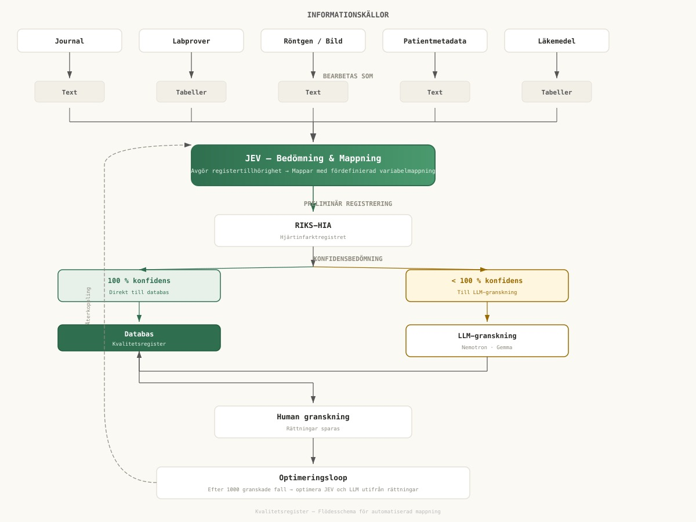
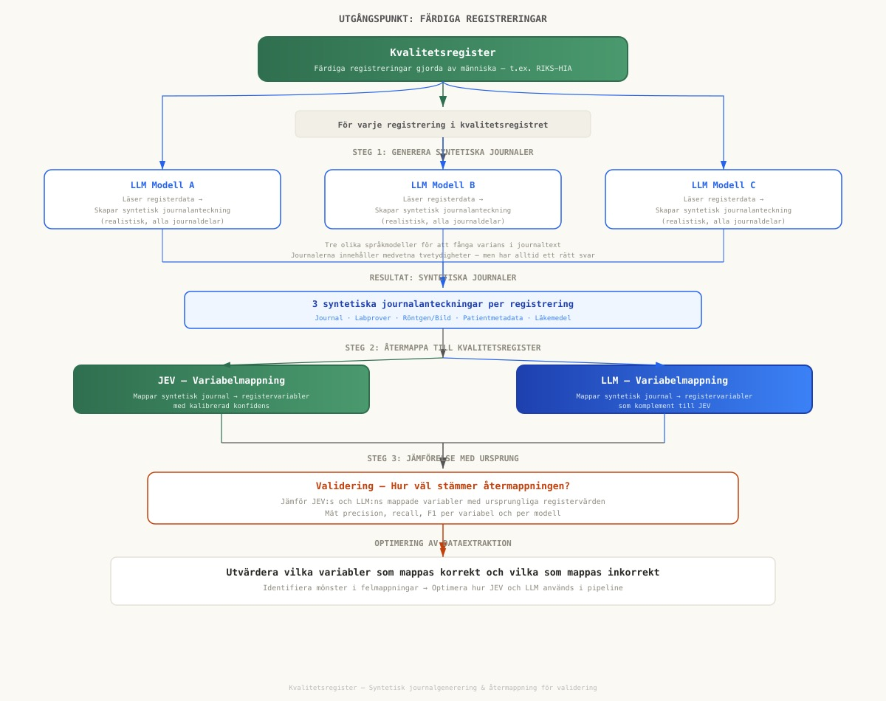

# Kvalitetsregister

**Exempel på extraktion:** [Vercel-app](https://kvalitetsregister.vercel.app)

Exempel på hur JEV kan användas för att mappa patientdata till kvalitetsregister med hjälp av JEV och LLM. Flödesschemat nedan visar processen från informationskällor via JEV:s variabelmappning till human granskning och optimering.

## Optimeringsloop

